<div align="center">


# Music

**A native-feeling iPhone music player for your own Jellyfin server.**
Built with React Native, Expo and TypeScript. Installed straight from GitHub — no App Store, no paid developer account.

[Install on your iPhone](#-install-on-your-iphone) · [Features](#-features) · [Architecture](#-architecture) · [Develop](#-develop)

</div>

---

## Why this exists

Streaming subscriptions rent you your own taste. If you already keep a music library on a home server, you want an app that treats it like a first-class citizen: instant search, offline playlists, a proper queue, and real album art — without handing a company your listening history.

This app talks directly to **Jellyfin** (your music), optionally to **Lidarr** (to find and fetch new albums), and stores nothing anywhere else. Playlists you edit here are real Jellyfin playlists, so they show up in every other Jellyfin client too.

## Screens

> These are renders of the design prototype in [`mockups/`](mockups) (open [`mockups/app.html`](mockups/app.html) in a browser — it's clickable). The app implements these screens. Images follow your GitHub light/dark theme. The prototype shows a placeholder brand name; the real app uses the name and icon from `app.json` and `assets/icon.png`.

<table>
<tr>
<td align="center" width="20%"><picture><source media="(prefers-color-scheme: dark)" srcset="docs/screens/login-dark.jpg">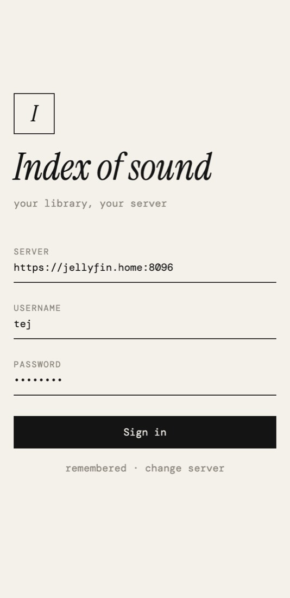</picture><br><sub><b>Sign in</b><br>server address is remembered</sub></td>
<td align="center" width="20%"><picture><source media="(prefers-color-scheme: dark)" srcset="docs/screens/home-dark.jpg">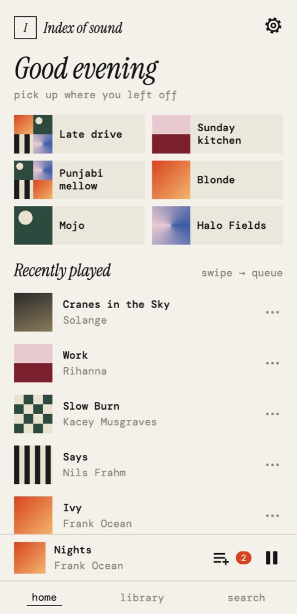</picture><br><sub><b>Home</b><br>recents, pinned, new albums</sub></td>
<td align="center" width="20%"><picture><source media="(prefers-color-scheme: dark)" srcset="docs/screens/library-dark.jpg">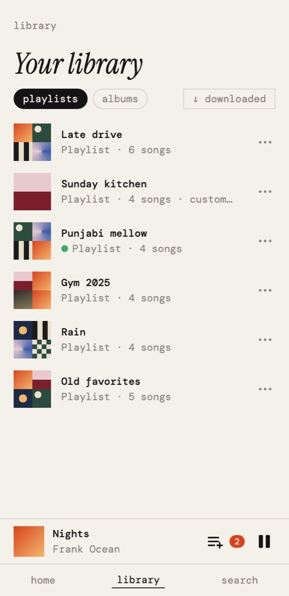</picture><br><sub><b>Library</b><br>playlists, pin, offline dot</sub></td>
<td align="center" width="20%"><picture><source media="(prefers-color-scheme: dark)" srcset="docs/screens/albums-dark.jpg">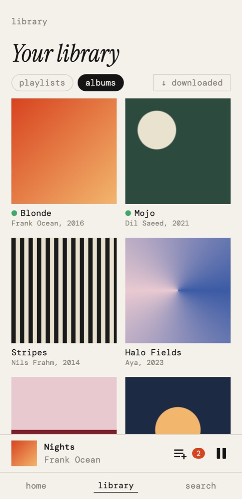</picture><br><sub><b>Albums</b><br>cover grid</sub></td>
<td align="center" width="20%"><picture><source media="(prefers-color-scheme: dark)" srcset="docs/screens/search-dark.jpg">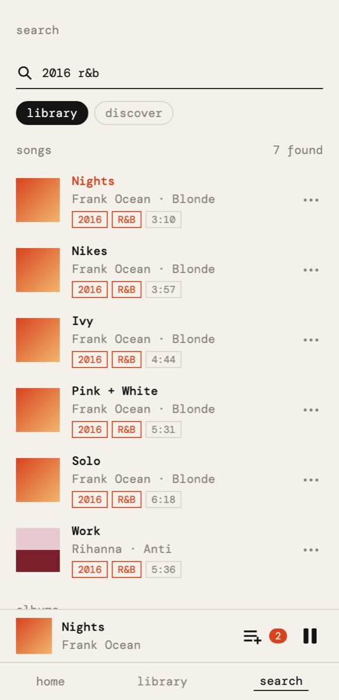</picture><br><sub><b>Search</b><br>title, artist, year, genre</sub></td>
</tr>
<tr>
<td align="center"><picture><source media="(prefers-color-scheme: dark)" srcset="docs/screens/discover-dark.jpg">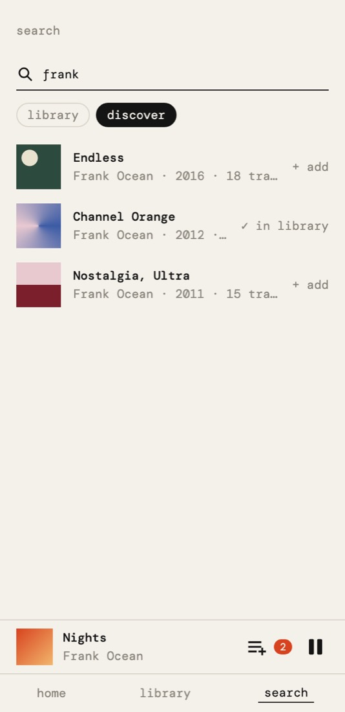</picture><br><sub><b>Discover</b><br>request new albums via Lidarr</sub></td>
<td align="center"><picture><source media="(prefers-color-scheme: dark)" srcset="docs/screens/menu-dark.jpg">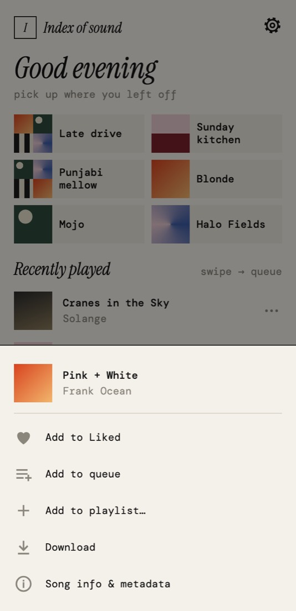</picture><br><sub><b>Song menu</b><br>like, queue, playlist, download</sub></td>
<td align="center"><picture><source media="(prefers-color-scheme: dark)" srcset="docs/screens/playlist-dark.jpg">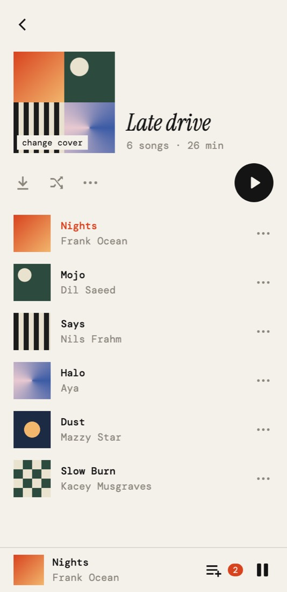</picture><br><sub><b>Playlist</b><br>download, shuffle, play</sub></td>
<td align="center"><picture><source media="(prefers-color-scheme: dark)" srcset="docs/screens/album-dark.jpg">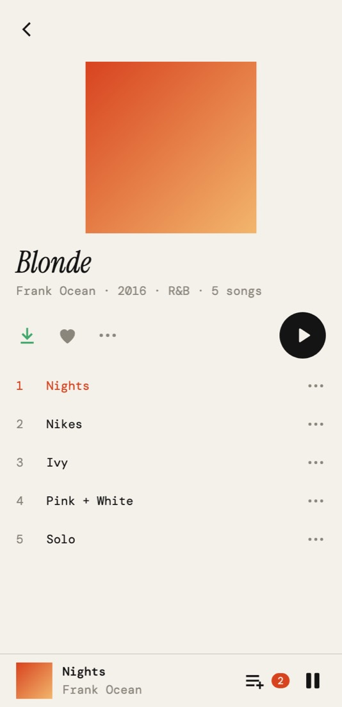</picture><br><sub><b>Album</b><br>swipe a track right to queue</sub></td>
<td align="center"><picture><source media="(prefers-color-scheme: dark)" srcset="docs/screens/songinfo-dark.jpg">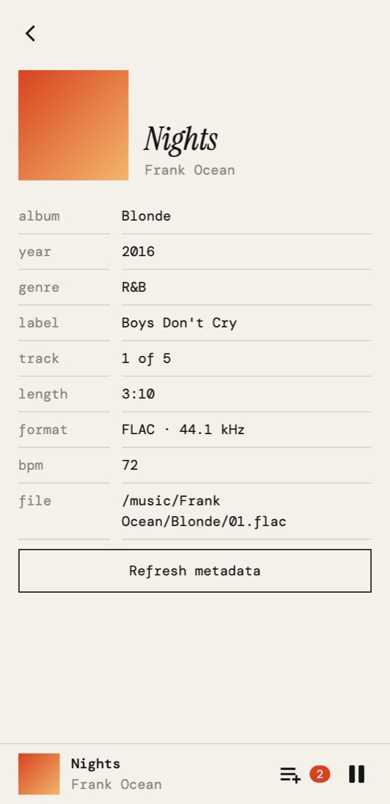</picture><br><sub><b>Song info</b><br>every tag Jellyfin knows</sub></td>
</tr>
<tr>
<td align="center"><picture><source media="(prefers-color-scheme: dark)" srcset="docs/screens/nowplaying-dark.jpg">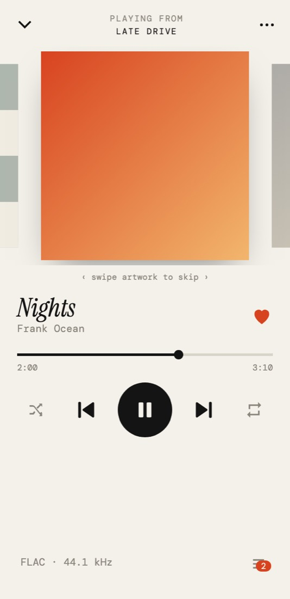</picture><br><sub><b>Now playing</b><br>swipe the art to skip</sub></td>
<td align="center"><picture><source media="(prefers-color-scheme: dark)" srcset="docs/screens/queue-dark.jpg">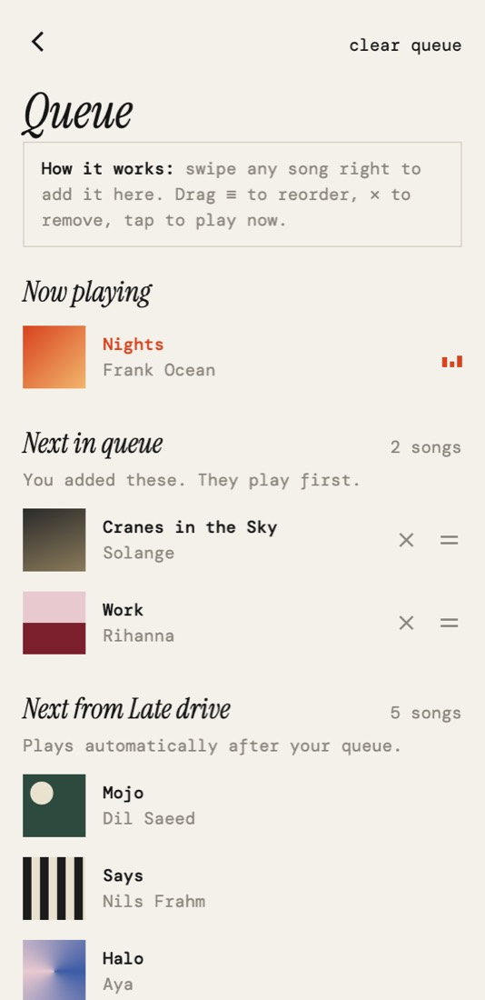</picture><br><sub><b>Queue</b><br>yours first, then the playlist</sub></td>
<td align="center"><picture><source media="(prefers-color-scheme: dark)" srcset="docs/screens/settings-dark.jpg">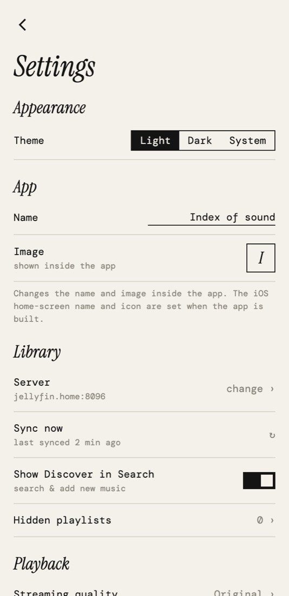</picture><br><sub><b>Settings</b><br>theme, Lidarr, metadata health</sub></td>
<td></td><td></td>
</tr>
</table>

The look is deliberately editorial: warm paper in light mode, near-black in dark, one vermillion accent, hairline borders, square album art, **DM Mono** for text and **Instrument Serif** italics for headings.

## ✨ Features

**Listening**
- Background playback with lock-screen, Control Center and headphone controls
- A real queue: swipe any song **right** to add it, drag to reorder, tap to jump. Songs you queue play *before* the rest of the playlist, like Spotify
- Now Playing with swipeable artwork, draggable seek bar, shuffle (upcoming songs only), repeat (off / all / one)
- Direct streaming — original files, no transcoding, so your server does almost no work

**Your library**
- Albums and playlists, with **pin to top** and **hide** (local to your phone; Jellyfin is never changed)
- Create playlists, add songs from anywhere, remove, reorder — all written to Jellyfin immediately
- A **Liked Songs** playlist (it's a normal Jellyfin playlist, so likes sync everywhere)
- Instant on-device search over title, artist, album, year and genre, with the matched year and genre shown as chips

**Offline**
- Download playlists, albums or single songs; un-download any time
- Songs shared between downloads are reference-counted, so removing one playlist never breaks another
- Green dot marks anything available offline; album art is cached for offline too

**Discover (optional)**
- Search the wider world through **Lidarr**, request an album, and optionally have it auto-added to Liked once it lands in Jellyfin

**Metadata**
- *Song info* screen shows everything Jellyfin knows: tags, codec, bitrate, file path, MusicBrainz IDs
- *Metadata health* scans your whole library for missing art, years, genres and MusicBrainz matches, and can queue a Jellyfin refresh for the gaps

**Polish**
- Light, dark and system themes
- Bottom-sheet menus, toasts, and a swipe-to-queue gesture on every song row

## 📲 Install on your iPhone

The app is distributed as an **unsigned `.ipa`** that GitHub Actions builds for you. You sign it with your own Apple ID using a sideloading tool. A free Apple ID works.

**You need:** an iPhone on iOS 16.4 or later · a Mac or Windows PC · a USB cable · a free Apple ID · a Jellyfin server you can reach from your phone.

### 1. Get the IPA

Pick one:

- **Download a release** — open the repo's **Releases** page and download `MyMusic-unsigned.ipa`.
- **Build it yourself in the cloud (recommended if you forked)** — fork this repo, open **Actions → Build iOS (unsigned IPA) → Run workflow**, wait for it to finish, then download the `MyMusic-unsigned.ipa` artifact. Pushing a tag like `v0.1.0` also builds it and attaches it to a Release.
- **From the terminal** — with the [GitHub CLI](https://cli.github.com) signed in: `./scripts/download-latest-build.sh` drops the newest successful build in `~/Downloads/MyMusic-latest/`.

### 2. Sideload it

1. Install **[Sideloadly](https://sideloadly.io)** (or AltStore / SideStore) on your computer.
2. On the iPhone: **Settings → Privacy & Security → Developer Mode → On**, then restart when asked.
3. Plug the phone in and tap **Trust** on the phone.
4. Open Sideloadly, drag in `MyMusic-unsigned.ipa`, enter your Apple ID, and click **Start**.
5. On the phone: **Settings → General → VPN & Device Management → your Apple ID → Trust**.
6. Open the app.

> **Free Apple ID limits:** the app expires after **7 days**. Re-run Sideloadly with the same IPA to refresh it (your login and downloads are normally kept). A paid developer account ($99/yr) lifts this to a year and enables TestFlight.

### 3. Connect to your server

Enter your Jellyfin address, e.g. `http://192.168.1.50:8096`, plus your username and password. Find the address in Jellyfin → Dashboard.

- iOS will ask for **Local Network** permission the first time — allow it, or the app can't see your server.
- Plain `http://` is allowed on purpose so home-LAN servers work without certificates.
- **Away from home?** Put the phone and server on the same private network with [Tailscale](https://tailscale.com) (easiest), or expose Jellyfin over HTTPS behind a reverse proxy.
- Your password is exchanged once for a token; only the token is stored, in the iOS Keychain.

### 4. Optional: Lidarr

Settings → **Discover** → enter Lidarr's URL (default port `8686`) and API key (Lidarr → Settings → General). Tap **Save & test**. You can hide Discover entirely with a switch.

### Troubleshooting

| Symptom | Fix |
|---|---|
| **"Cannot reach server"** | Not a password problem. Check the URL (include `http://` and the port), that phone and server share a network or VPN, and that Local Network permission is on (iOS Settings → this app → Local Network). Try the URL in Safari first. |
| Sideloadly `LOCKDOWN_E_INVALID_HOST_ID` | Re-pair: unplug, tap *Trust* on the phone again, or reset Settings → General → Transfer or Reset → Reset Location & Privacy. |
| App won't open, "Untrusted Developer" | Step 5 above. |
| App stopped opening after a week | The 7-day signature expired; re-run Sideloadly. |
| Covers or tags missing | That's Jellyfin's data, not the app's. See [Metadata](#metadata-getting-art-and-tags-right). |
| CI build fails on Swift errors | The workflow selects the newest Xcode on the runner; Expo SDK 58 needs Swift 6.2+. |

## 🧱 Tech stack

| Layer | Choice | Why |
|---|---|---|
| App framework | **Expo SDK 58**, **React Native 0.88**, **React 19**, **TypeScript** | One TS codebase; Android reuses it later |
| Build | Expo prebuild + `xcodebuild` on a **GitHub Actions** macOS runner | No Mac or Xcode needed locally; output is an unsigned IPA |
| Audio | **react-native-track-player** | Real background audio, lock screen and remote controls. Requires a development build, so **Expo Go can't run this app** |
| Navigation | React Navigation 7 (bottom tabs inside a native stack) | Native transitions; custom tab bar docks the mini-player |
| Server data | **TanStack React Query** | Caching, dedupe, background refresh |
| App state | **zustand** | Tiny stores for auth, queue mirror, settings, pins, toasts |
| Local storage | **expo-sqlite** (downloads index + key-value prefs), **expo-secure-store** (tokens, API keys), **expo-file-system** (audio files) | Right tool per data type |
| Images | **expo-image** | Disk cache, so artwork loads once and works offline |
| Gestures / graphics | **react-native-gesture-handler**, **react-native-svg** | Reliable swipe-in-list; one icon set drawn on a 24px grid |
| Typography | DM Mono · Instrument Serif (via `@expo-google-fonts`) | The editorial look |
| Backends | **Jellyfin** REST API · **Lidarr** API v1 | Library + playlists · discovery |

## 🏛 Architecture

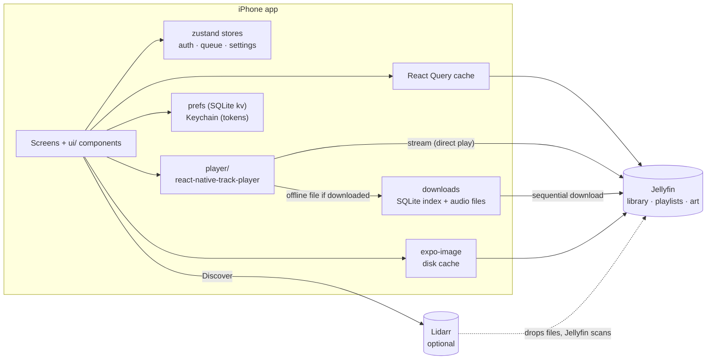

### Folder map

```
App.tsx                  providers, fonts, tab + stack navigators
index.ts                 registers the app and the background playback service
src/
  api/                   jellyfin.ts · lidarr.ts · types.ts      (all network code)
  player/                queue.ts (queue model) · recents.ts · setup.ts · service.ts
  downloads.ts           SQLite-backed offline store (reference-counted)
  downloadActions.ts     "download / remove" flows shared by screens
  likes.ts               Liked Songs = a Jellyfin playlist
  state/                 auth · settings · library (pins/hidden)
  storage/               session + Lidarr (Keychain) · prefs (SQLite kv)
  navigation/            navigation ref so non-screen code can navigate
  screens/               one file per screen
  ui/                    design system: theme, Txt, Icon, rows, sheets, toast…  (see ui/README.md)
scripts/                 download-latest-build.sh · set-branding.sh
.github/workflows/       build-ios.yml   (tag or manual → unsigned IPA)
mockups/                 clickable HTML design prototype
docs/                    README images
```

### How the important parts work

**Playback.** `react-native-track-player` owns the native queue. `player/queue.ts` mirrors it into a zustand store so any screen can render it, and tags songs you add by hand with `queued: true`. Hand-queued songs are inserted right after the current track (and after earlier hand-queued ones), which is what lets the Queue screen show *"Next in queue"* separately from *"Next from <playlist>"*. If a song is downloaded, its local file URL is used instead of the stream URL, so playback is seamless offline.

**Offline downloads.** One SQLite table maps tracks to files, another maps *download units* (a playlist, an album or a single song) to tracks. Removing a unit deletes only files no other unit still needs. Downloads run one at a time to stay gentle on the server, and progress is a tiny store so rows re-render cheaply.

**Likes and playlists.** Everything is stored in Jellyfin, so other clients see it. "Liked Songs" is just a playlist with a fixed name, created on first like. Only presentation preferences — pinned, hidden, recents, theme — live on the phone, because they have no Jellyfin equivalent.

**Search.** The first time you open Search the app downloads a lightweight list of your songs and albums (title, artist, album, year, genre) and matches against it locally. That's why results appear as you type and why year and genre work, which Jellyfin's own search endpoint doesn't match.

**Caching, in layers.**
1. React Query keeps server responses fresh for a minute and dedupes requests.
2. `expo-image` keeps cover art on disk. Image URLs snap to three fixed sizes so each cover is fetched once, and downloading a playlist pre-warms its art.
3. Downloaded audio lives in the app's documents folder.
4. The search index is held in memory for the session.

**Security.** No credentials are in this repo. Your Jellyfin token and Lidarr key are stored in the iOS Keychain via `expo-secure-store`; preferences go in local SQLite. The app only talks to the servers you type in.

**Design system.** Components never hard-code colors; they read the palette through `useColors()`. Rows are a fixed height so queue drag-reordering can compute the drop slot arithmetically. See [`src/ui/README.md`](src/ui/README.md).

## 🎨 Metadata: getting art and tags right

The app shows exactly what Jellyfin knows. Jellyfin builds that from the **tags embedded in your files** (artist, album, year, genre, cover) plus online lookups (MusicBrainz, TheAudioDB), which only match well when tags are clean.

1. Open **Settings → Metadata health** to see how many albums lack art, year, genre or a MusicBrainz match.
2. Clean the files with [MusicBrainz Picard](https://picard.musicbrainz.org) or [beets](https://beets.io) — they fix tags, embed cover art and add MusicBrainz IDs.
3. In Jellyfin: Dashboard → Libraries → your music library → enable the MusicBrainz and TheAudioDB downloaders and image fetchers.
4. Scan the library with **Replace all metadata**, or tap **Refresh albums with gaps** in the app.
5. Settings → **Sync now** reloads the app's caches.

## 🛠 Develop

```bash
npm install
npx tsc --noEmit            # typecheck
npx expo export --platform ios --output-dir /tmp/out   # confirms the JS bundle compiles
```

Because of native modules (`react-native-track-player`, SQLite, gesture handler…) the app needs a **development build** — `npx expo run:ios` on a Mac with Xcode, or the GitHub Actions workflow for everyone else. Expo Go will not run it.

**Rebuilding after changes:** push to GitHub, run the workflow (or push a `v*` tag), then `./scripts/download-latest-build.sh` and reinstall with Sideloadly.

**Branding.** The home-screen name and icon are fixed at build time by iOS and cannot be changed from inside any app. To change them:

```bash
./scripts/set-branding.sh "My Music" path/to/icon.png   # name and image; image is optional
```

Then rebuild. (For a quick personal look without rebuilding, the iOS Shortcuts app can add a home-screen shortcut with a custom name and icon.)

## 🗺 Status and roadmap

**Working:** sign-in, library browsing, search, playlists (create/add/remove/reorder/pin/hide), likes, queue, Now Playing, offline downloads, Lidarr discovery, metadata tools, light/dark themes.

**Being tuned on real devices:** swipe-to-queue feel, seek-bar and queue-drag gestures, tab-bar and mini-player spacing.

**Not built yet:**
- Android build (icons are configured; no build workflow or testing yet)
- Custom playlist covers from photos
- Offline-first playlist edits that sync later
- Search by label and BPM
- Crossfade, volume normalization, streaming-quality and cellular-download switches
- Reporting plays back to Jellyfin (so play counts stay in sync)

## 🙏 Built on

[Jellyfin](https://jellyfin.org) · [Lidarr](https://lidarr.audio) · [Expo](https://expo.dev) · [React Native](https://reactnative.dev) · [react-native-track-player](https://rntp.dev) · [TanStack Query](https://tanstack.com/query) · [zustand](https://zustand-demo.pmnd.rs) · DM Mono and Instrument Serif (SIL Open Font License) · [Sideloadly](https://sideloadly.io)

This is an independent project and is not affiliated with Jellyfin, Lidarr or Apple.
